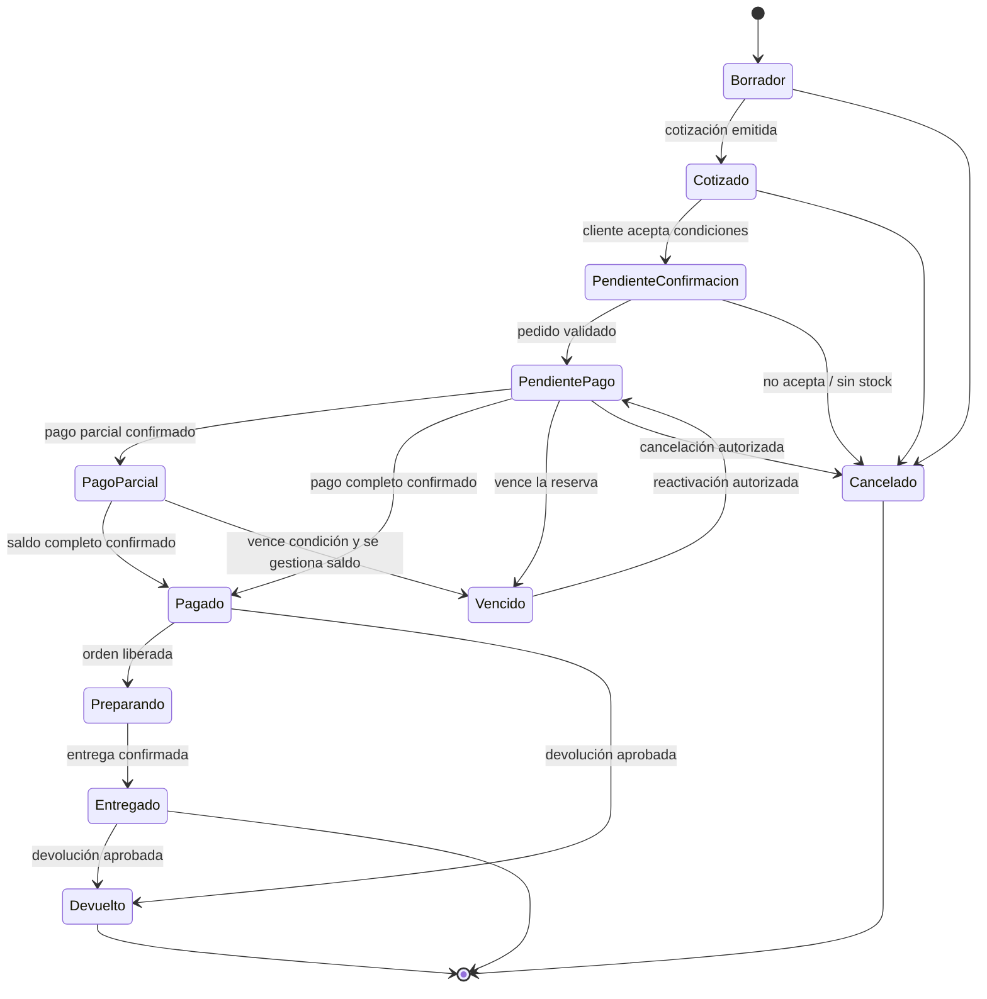
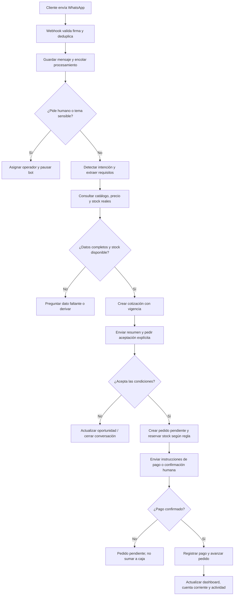
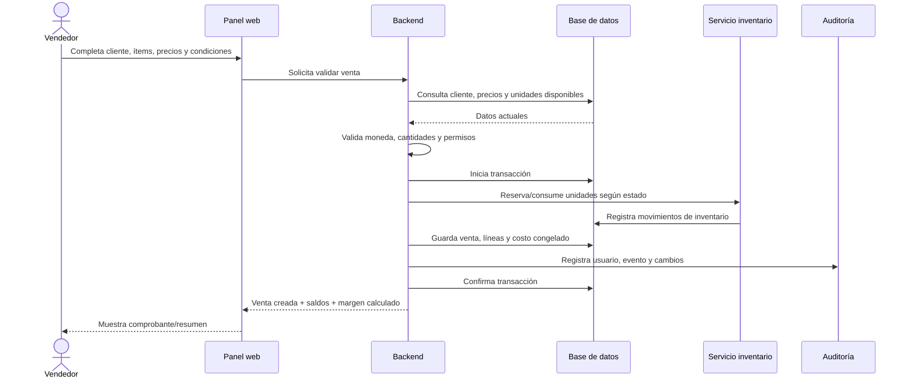
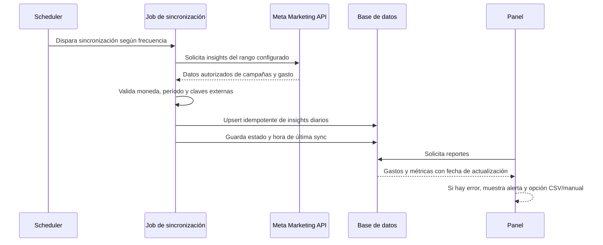
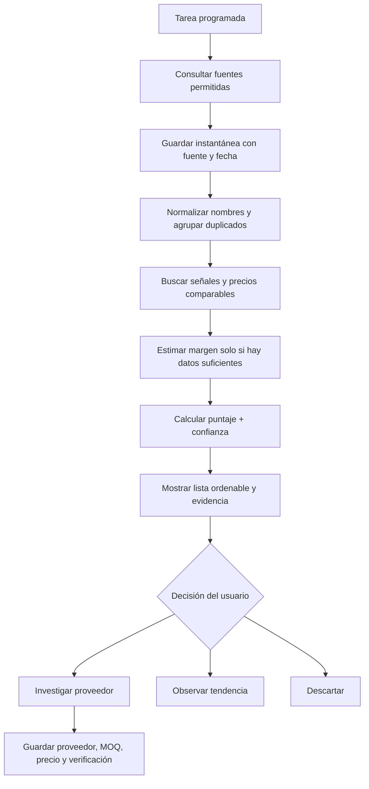
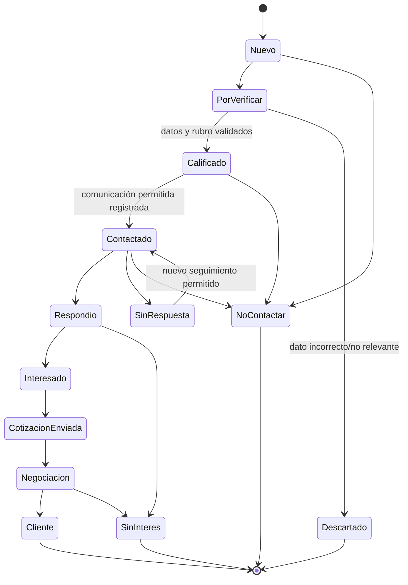

# Especificación funcional y técnica
## Sistema inteligente de ventas, finanzas, inventario, tendencias y prospección mayorista

**Versión:** 1.0  
**Fecha:** 28 de octubre de 2026  
**Contexto inicial:** negocio de importación y venta mayorista de iPhones desde Miami; arquitectura preparada para otras categorías de productos.  
**Objetivo:** documento de análisis y prompt maestro para Claude Code.

---

## 1. Resumen ejecutivo

Construir una aplicación web privada que actúe como centro de operaciones del negocio y conecte cuatro áreas:

1. **Finanzas, compras, inventario y ventas:** saber cuánto se compró, cuánto costó cada unidad una vez puesta en el país, qué se vendió, cuánto se cobró, cuánto se adeuda y cuál fue el resultado del negocio.
2. **Atención y ventas por WhatsApp:** responder preguntas usando datos reales del sistema, preparar cotizaciones, calificar prospectos y registrar oportunidades/pedidos cuando corresponda, con derivación a una persona cuando sea necesario.
3. **Radar de tendencias:** combinar señales comprobables de demanda con estimaciones explícitas de margen y competencia; mostrar puntaje, evidencia, fecha y enlaces para investigar proveedores.
4. **Prospección de compradores mayoristas:** buscar comercios, guardar contactos empresariales de fuentes permitidas, deduplicar registros y organizar un CRM de seguimiento.

**Principio rector:** automatizar el trabajo repetitivo, pero no inventar cifras ni ejecutar acciones irreversibles sin validación. Los indicadores financieros deben derivarse de transacciones registradas. Las recomendaciones de tendencias deben mostrar fuentes y nivel de confianza. El bot nunca debe inventar stock, precio, condición, garantía ni fecha de entrega.

## 2. Alcance y presupuesto: decisión crítica

Los cuatro módulos completamente integrados representan un proyecto significativo. No se debe prometer que las cuatro áreas estarán maduras por un pago fijo de ARS 500.000 sin limitar expresamente el alcance, las integraciones y la cantidad de iteraciones. Se recomienda dividir la entrega en hitos y que el cliente pague directamente los servicios externos, hosting, consumo de APIs, número de WhatsApp y servicios de IA que apruebe.

### MVP recomendado como primera entrega

- Acceso privado y panel adaptable a móvil y escritorio.
- Catálogo de productos, variantes y unidades individuales con IMEI/serie opcional/obligatorio según tipo de producto.
- Registro de compras/lotes, costos adicionales y costo puesto en destino por unidad.
- Registro manual de ventas, cobros, gastos y cuentas por cobrar.
- Dashboard financiero básico con ingresos cobrados, ventas confirmadas, gastos, margen bruto estimado, resultado operativo y stock.
- Clientes y compradores mayoristas en un CRM básico.
- Radar inicial con la API de tendencias de Mercado Libre, enlaces de búsqueda de proveedores y puntaje explicado.
- Importación/exportación CSV y reportes básicos.
- Base de integración de WhatsApp aislada detrás de un adaptador. Activarla en producción requiere credenciales, configuración y pruebas de la cuenta de Meta del cliente.

### Integraciones que deben cotizarse o aprobarse como hitos separados

- Bot de WhatsApp Cloud API en producción, plantillas y proceso de verificación/configuración de Meta.
- Sincronización de gasto de Meta Ads mediante Marketing API y permisos de la cuenta publicitaria.
- Google Places API para prospección con datos de contacto; la API puede generar cargos por campos solicitados y requiere configurar facturación/cuotas.
- Modelos de IA de pago, si se eligen; no incluir una API de IA paga por defecto.
- Flujos avanzados en n8n, envío de campañas, proveedores extra, conciliación bancaria, pagos online y predicción sofisticada.

Si el contrato actual afirma que las cuatro áreas completas están incluidas en los ARS 500.000, conviene redefinir entregables y criterios de aceptación por escrito antes de comprometer una fecha. Este documento define la visión completa; no convierte automáticamente todas las integraciones en gratuitas ni garantiza acceso a ellas.

## 3. Objetivos y métricas de éxito

- Registrar una operación de venta manual en menos de 60 segundos una vez cargados los productos y clientes.
- Conocer stock disponible por modelo, capacidad, color, condición y, cuando aplique, IMEI/serie.
- Calcular el costo unitario de destino a partir del lote de compra y sus costos asociados.
- Separar ventas, cobros, cuentas por cobrar, gastos y caja disponible.
- No duplicar una venta, mensaje, pago ni gasto aunque un webhook o tarea se procese más de una vez.
- Mostrar en cada dato sincronizado fuente, moneda, fecha/hora y estado de sincronización.
- Mostrar en cada oportunidad de producto su evidencia, fecha de consulta, puntaje y grado de confianza.
- Registrar quién creó o modificó una venta, pago, gasto o ajuste de stock.
- Permitir que el dueño siga cerrando ventas manualmente si falla WhatsApp, Meta, Google o un proveedor de IA.

## 4. Usuarios y permisos

### Roles iniciales

- **Propietario/administrador:** acceso completo, configuración, finanzas, proveedores, campañas, integraciones y usuarios.
- **Vendedor/operador:** clientes, cotizaciones, pedidos y ventas; no puede borrar movimientos financieros confirmados ni modificar credenciales.
- **Analista (opcional):** reportes, tendencias y prospectos; sin modificar caja ni inventario.

En el MVP puede existir un único usuario administrador, pero el modelo de permisos debe evitar un rediseño si se agregan usuarios después.

## 5. Módulo de finanzas, compras e inventario

### 5.1 Dashboard

Filtros por día, semana, mes, rango personalizado y moneda de reporte. Mostrar por separado:

- Ventas confirmadas del período.
- Dinero efectivamente cobrado en el período.
- Cuentas por cobrar pendientes y vencidas.
- Costos de mercadería vendida (COGS) calculados a partir del costo unitario del inventario.
- Ganancia bruta: ventas netas menos costo de mercadería vendida.
- Gastos operativos, con categoría y origen.
- Resultado operativo estimado: ganancia bruta menos gastos operativos registrados.
- Entradas y salidas de caja, saldo inicial/final y pagos pendientes.
- Gastos de Meta Ads sincronizados, indicando fecha de última actualización y cuenta publicitaria.
- Stock disponible, reservado y comprometido; valor del inventario a costo.

No llamar “ganancia neta real” a un cálculo que no contempla impuestos, comisiones, costos financieros o gastos todavía no cargados. El dashboard debe incluir una nota de cobertura: “calculado con movimientos registrados hasta [fecha/hora]”.

### 5.2 Catálogo universal

Cada producto tendrá categoría, marca, nombre, SKU interno, descripción, fotos opcionales, estado activo/inactivo y atributos flexibles. Evitar que la lógica quede atada exclusivamente a iPhones.

Para iPhones, contemplar atributos como modelo, almacenamiento, color, condición (nuevo/usado/reacondicionado), salud de batería si corresponde, bloqueo/operador, región, garantía y notas de inspección. No inventar ni deducir atributos ausentes.

### 5.3 Unidades serializadas

Para celulares, cada unidad física podrá registrar IMEI, IMEI secundario si corresponde, número de serie, estado de condición, origen/lote, ubicación, costo asignado y estado de inventario. Restringir la visibilidad de IMEI/serie a roles autorizados. Validar duplicados, pero permitir productos no serializados en otras categorías.

Estados de inventario sugeridos: `en_transito`, `en_revision`, `disponible`, `reservado`, `vendido`, `devuelto`, `en_garantia`, `perdido`.

### 5.4 Compras e importación

Registrar proveedor, factura/orden de compra, fecha, moneda, tipo de cambio aplicado, ítems, cantidades, coste unitario en origen, descuentos, flete, seguro, aranceles/impuestos, despacho, traslados y otros costos atribuibles.

El sistema permitirá elegir un método configurable para distribuir costos adicionales entre unidades: proporcional al valor de compra como regla inicial. Guardar el método y el resultado de la asignación en el lote para que sea auditable. No recalcular silenciosamente costos históricos si el usuario modifica después el tipo de cambio.

Fórmula orientativa:

`Costo puesto en destino del lote = costo de mercadería + costos atribuibles del lote`

`Costo unitario asignado = costo total del lote distribuido según el método seleccionado / unidades válidas del lote`

Registrar devoluciones, faltantes, unidades dañadas y diferencias entre lo comprado y lo recibido.

### 5.5 Ventas, cotizaciones, cobros y créditos

- Una cotización puede convertirse en pedido/venta conservando los precios y condiciones aceptados.
- Una venta contiene cliente, vendedor, ítems, cantidad, precios, descuentos, moneda, fecha, condición de pago, costo de los ítems y estado.
- Registrar múltiples pagos parciales y medios de cobro: efectivo, transferencia, tarjeta, billetera y otros configurables.
- Calcular saldo por cobrar y vencimientos cuando se vende a crédito.
- Separar pedido pendiente, confirmado, pagado parcial, pagado, enviado/entregado, cancelado y devuelto.
- El stock se reserva al confirmar un pedido, según configuración; se descuenta definitivamente al despachar/entregar. Liberar la reserva al cancelar.
- Toda corrección de venta confirmada debe generar una reversión/nota de ajuste auditable; no eliminarla en silencio.

### 5.6 Gastos y caja

Registrar categoría, proveedor, importe original, moneda, tipo de cambio, fecha de emisión, fecha de pago, método, comprobante adjunto opcional, recurrencia opcional y observación. Separar gasto devengado de gasto pagado si la operación lo requiere.

Categorías iniciales: publicidad, flete, despacho, impuestos/aranceles, almacenamiento, comisiones, servicios, software, logística, combustible/transporte, devoluciones/garantías y otros.

No duplicar el gasto de Meta Ads: si una campaña se refleja en la sincronización de Meta, etiquetarlo como gasto importado y bloquear una segunda importación con la misma clave externa. Permitir ajuste manual con trazabilidad.

### 5.7 Multi-moneda

Guardar moneda original, importe original, tipo de cambio aplicado, fecha/fuente de cotización y equivalente en moneda de reporte. No convertir ventas históricas usando la cotización actual. Configurar moneda base (por defecto ARS) y permitir USD como moneda operativa por las compras en Miami.

### 5.8 Reportes

Ventas por día y por producto; margen por venta y por modelo; compras y costo promedio; caja; pagos pendientes; cuentas por cobrar; clientes mayoristas más activos; gastos por categoría; campañas Meta; rotación de stock y productos inmovilizados. Exportar CSV; PDF puede quedar para etapa posterior si complica el MVP.

## 6. Módulo WhatsApp: bot de consultas y asistencia comercial

### 6.1 Integración

Usar **WhatsApp Business Platform Cloud API oficial**, con webhooks entrantes y API oficial de envío. No automatizar WhatsApp Web mediante Selenium, extensiones no oficiales o librerías que simulen un cliente si se busca una operación estable. La activación en producción depende de la configuración y los permisos de la cuenta del negocio.

Crear una interfaz interna `MessagingProvider` para aislar WhatsApp. Guardar IDs externos, timestamps, estados de entrega y claves de idempotencia. El webhook debe responder rápido y delegar el trabajo pesado a una cola.

### 6.2 Funciones del bot

- Saludar y detectar intención: precio/stock, especificaciones, compra mayorista, cotización, entrega, garantía, seguimiento o hablar con una persona.
- Consultar en tiempo real el catálogo, stock disponible, condición, moneda, vigencia de precios y mínimos mayoristas.
- Hacer preguntas breves para entender modelo, capacidad, condición, cantidad, localidad y método de pago cuando haga falta.
- Preparar una cotización estructurada y guardarla en el sistema.
- Consultar el estado de un pedido validando la identidad de manera apropiada.
- Derivar a una persona cuando la información no está disponible, hay negociación especial, duda legal/tributaria, reclamo, garantía o el cliente lo solicita.
- Crear recordatorios de seguimiento solo si las políticas y permisos lo permiten.
- Guardar la conversación con acceso limitado y una política de retención configurable.

### 6.3 Reglas comerciales y de seguridad

- El bot solo puede responder precios y stock mediante una consulta al sistema. Ante error de conexión, debe decir que necesita verificarlo; nunca inventar.
- No prometer importación, entrega, autenticidad, garantía o devolución si esa condición no está configurada.
- No cerrar una venta solo porque un mensaje parezca positivo. Confirmar productos, cantidad, precio, moneda, entrega y método/condición de pago.
- Cuando el cliente acepta la cotización, crear por defecto un **pedido pendiente de pago/confirmación**, con vencimiento de reserva configurable. No marcar el dinero como cobrado sin una confirmación del medio de pago.
- Si la venta requiere negociación, autorización o stock no disponible, crear una tarea para el dueño.
- Incluir comando/acción de derivación a un humano y suspender el bot para esa conversación hasta que el operador la cierre o la reactive.
- Registrar el texto/respuesta enviada y las fuentes internas consultadas; no almacenar secretos ni tokens en mensajes.
- Detectar expresiones de baja/opt-out y evitar nuevos mensajes promocionales al contacto.

### 6.4 Ventana de atención y costos

La política de WhatsApp Business actual indica que solo se debe contactar a una persona si proporcionó el número y dio permiso para recibir mensajes; fuera de la ventana de atención de 24 horas, para iniciar o retomar una conversación se requieren plantillas aprobadas. La política también exige respetar solicitudes de baja y disponer de una vía clara de escalamiento a una persona. Verificar las reglas vigentes y tarifas antes de producción: pueden cambiar.

No incluir costes de WhatsApp, número, proveedor intermediario ni IA en el coste de desarrollo sin aprobación expresa.

## 7. Módulo de tendencias y oportunidades de producto

### 7.1 Objetivo y límites

El sistema ayuda a descubrir candidatos y priorizarlos; no garantiza ventas futuras ni “predice con certeza” el producto ganador. Mostrar evidencia verificable, país, período, fecha de captura, fuente, calidad del dato y limitaciones. Si una fuente no entrega volumen de ventas exacto, no fabricar un número de ventas.

### 7.2 Fuentes propuestas

**Primera fuente de datos estructurada:** API de tendencias de Mercado Libre para Argentina (`MLA`). Su documentación describe 50 términos por consulta, con grupos asociados al crecimiento, a búsquedas deseadas y a tendencias populares, actualización semanal y filtros por categoría. Requiere respetar autenticación/condiciones y confirmar el comportamiento vigente durante la implementación.

**Fuentes complementarias para investigar desde el MVP:** enlaces a Google Trends, TikTok Creative Center, categorías de marketplace y buscadores de proveedores. La API de Google Trends anunciada por Google sigue documentada como alfa con acceso limitado; no depender de ella para que la primera versión funcione.

La API de la Biblioteca de Anuncios de Meta no debe presentarse como una API universal para analizar todos los anuncios de productos de Argentina: la documentación pública describe acceso especial para anuncios políticos/sociales y anuncios de ciertos territorios como la UE/Reino Unido. Para el gasto publicitario del propio cliente, usar Marketing API con permisos concedidos por el dueño de su cuenta publicitaria.

### 7.3 Flujo de análisis

1. Ejecutar consultas según país/categoría en una tarea programada.
2. Guardar una instantánea con fuente, fecha, palabra clave, enlace original y posición/tipo de tendencia devuelto.
3. Normalizar variantes de nombres y agrupar duplicados sin borrar la fuente original.
4. Generar enlaces de investigación de proveedores para la búsqueda del producto; esos enlaces son atajos de búsqueda, no afirmaciones de que un proveedor esté validado.
5. Estimar margen únicamente cuando haya precio de compra y precio de venta comparables, con moneda, condición, logística e impuestos explicitados.
6. Calcular el puntaje y su confianza.
7. Permitir que el usuario marque `investigar`, `contactar proveedor`, `muestra solicitada`, `aprobado`, `descartado` o `comprado`.

### 7.4 Puntaje propuesto 0-100

- 30%: señal de demanda observable (tendencias/búsquedas con fuente).
- 20%: aceleración reciente cuando la fuente permita comparar períodos.
- 25%: margen potencial, solo si hay precios comparables y costos editables.
- 10%: competencia observable y saturación aproximada.
- 10%: disponibilidad/diversidad de proveedores investigados.
- 5%: completitud/calidad de la evidencia.

El puntaje debe adaptar la ponderación si falta una señal, documentar qué datos faltan y bajar la confianza. No mostrar un puntaje con apariencia de precisión matemática si solo hay datos insuficientes. Mostrar por ejemplo: `Puntaje 72/100 · Confianza media · Basado en 3 señales · Actualizado hace 2 días`.

Los comentarios, ratings, cantidad de ventas o precios se usan solo si la fuente elegida realmente ofrece esos campos mediante un método permitido. Las cifras de ventas no se deducen únicamente de comentarios o reseñas.

### 7.5 Enlaces de proveedores

Generar consultas parametrizadas hacia sitios como Alibaba, Global Sources, Made-in-China u otros aprobados por el dueño. Incluir enlaces de búsqueda del término y espacio para guardar proveedor, URL exacta, precio, MOQ (mínimo de compra), condiciones de envío, fecha consultada y nota de riesgo.

No afirmar que un producto de marca es auténtico ni que un proveedor es confiable solo porque aparezca en un buscador. Para iPhones, incluir checklist de validación del proveedor, IMEI/serie, estado de activación/bloqueo, procedencia, factura, garantía, unidades defectuosas y costes de importación. No comprar automáticamente.

## 8. Buscador de clientes mayoristas y CRM

### 8.1 Objetivo

Encontrar comercios relevantes —tiendas de celulares, revendedores y distribuidores— primero para iPhones y, en el futuro, para otras categorías. Almacenar contactos de negocios con fuente, fecha y estado de validación, evitando registros duplicados.

### 8.2 Fuentes y métodos

- **Google Places API:** búsqueda por texto, ciudad o zona. Elegir solo los campos necesarios mediante `FieldMask`; campos de contacto y solicitudes adicionales pueden tener un costo distinto. Configurar cuotas, alertas y límites de gasto. La API limita los resultados por consulta/paginación; no prometer “todos los contactos de todas las tiendas”.
- Importación manual/CSV de listas propias o adquiridas legalmente.
- Alta manual desde visitas, referencias y formularios.
- Web y redes sociales públicas: guardar URL/perfil y permitir verificación humana; no extraer a escala datos de forma contraria a los términos de una plataforma.

### 8.3 Ficha del prospecto

Nombre comercial, tipo de negocio, ciudad/provincia/país, teléfono, email/website si está disponible, fuente, URL de origen, fecha de captura, fecha de última verificación, notas, categoría de interés, volumen potencial estimado (manual, no inventado), estado, dueño asignado, consentimiento/permiso de contacto y motivo de exclusión.

Estados: `nuevo`, `por_verificar`, `calificado`, `contactado`, `respondio`, `interesado`, `cotizacion_enviada`, `negociacion`, `cliente`, `sin_interes`, `no_contactar`.

### 8.4 Dedupe y privacidad

Normalizar teléfonos con código de país, comparar dominio/nombre comercial y permitir fusión manual de duplicados. Conservar fuente y trazabilidad. Registrar opt-in específico para WhatsApp/marketing, fecha y método de obtención; permitir baja global o por categoría y mantener lista de supresión. No iniciar mensajes de WhatsApp masivos a números encontrados en mapas o redes sin el permiso requerido. La ley argentina de datos personales exige que los datos sean adecuados, pertinentes, no excesivos y no recolectados por medios desleales; implementar retención y procesos para corregir o suprimir datos cuando corresponda.

### 8.5 Seguimiento comercial

Vista de pipeline Kanban y tabla con filtros. Cada actividad registra fecha, resultado, responsable y siguiente paso. Las campañas iniciales pueden generar una lista para revisión humana; no automatizar envíos masivos por defecto.

## 9. Integración de gasto de Meta Ads

Conectar la cuenta publicitaria propia del cliente mediante OAuth/permisos de la aplicación Meta y Marketing API, siempre que el usuario conceda acceso apropiado. Leer insights por cuenta/campaña/conjunto/anuncio según permisos y límites vigentes.

Datos posibles: cuenta, campaña, período, gasto, moneda, impresiones, clics y otros indicadores disponibles con permisos. Guardar `external_id`, período, fecha de sincronización y respuesta resumida. Usar una clave única para no importar dos veces la misma cuenta/campaña/período.

- No solicitar contraseñas personales de Facebook.
- No guardar tokens en el repositorio, frontend o logs.
- Si faltan permisos o la API falla, mostrar `desconectado`, `permiso insuficiente` o `última sincronización fallida` y permitir importación CSV/manual.
- La lectura de Insights no equivale a atribución exacta de una venta. Si en el futuro se desea atribución, requerirá reglas explícitas, UTMs o integración adicional y se presentará como estimación.

## 10. Arquitectura técnica recomendada

### 10.1 Estilo

**Monolito modular**, no microservicios. Es más fácil de entregar, probar, desplegar y operar para un único negocio con volumen inicial limitado. Mantener módulos separados por dominio y contratos explícitos para integraciones.

### 10.2 Stack sugerido

- Backend: Laravel en versión estable compatible con el entorno existente.
- UI: Vue 3 + TypeScript; Nuxt si el repositorio actual ya lo utiliza o si la separación frontend/API está justificada. No migrar el stack sin una razón demostrable.
- Base de datos relacional: aprovechar la existente si el proyecto ya tiene una; si se inicia de cero, elegir MySQL 8 o PostgreSQL y usarla consistentemente.
- Redis y colas para webhooks, sincronizaciones, reportes y tareas lentas, si el hosting lo permite; de lo contrario, comenzar con cola compatible y migrar sin cambiar la lógica de negocio.
- Scheduler del framework para tareas periódicas.
- n8n opcional para flujos de notificación y conectores periféricos. La lógica financiera, validaciones, deduplicación e idempotencia deben vivir en el backend, no exclusivamente en n8n.
- Docker Compose para entorno local si coincide con el entorno existente.

### 10.3 Capas

- **Presentación:** dashboard, formularios, tablas, gráficos y estados de carga/error.
- **Aplicación:** casos de uso como `RegistrarVenta`, `RegistrarCobro`, `RecibirMensajeWhatsApp`, `SincronizarMetaAds` y `ActualizarTendencias`.
- **Dominio:** reglas de costo, margen, stock, reserva, ventas y permisos.
- **Persistencia:** repositorios/consultas, migraciones, índices y transacciones.
- **Integraciones:** adaptadores para WhatsApp, Meta Marketing API, Google Places, Mercado Libre y proveedor IA, cada uno desacoplado del dominio.
- **Jobs/colas:** procesamiento de webhooks, sincronizaciones, reintentos y tareas programadas.

### 10.4 Reglas de arquitectura

- No crear microservicios para este alcance inicial.
- No almacenar tokens/secrets en Git ni enviarlos al frontend.
- No acoplar la lógica financiera a la respuesta del bot o a un proveedor IA.
- Implementar `dry-run`/modo demo para probar integraciones sin acciones externas.
- Todas las integraciones pueden quedar desactivadas sin impedir el registro manual de ventas.
- Las llamadas externas tienen timeout, manejo de rate limit, reintentos con backoff e idempotencia.
- Guardar eventos de sincronización con estado, duración, último error sanitizado y fecha.

## 11. Modelo de datos inicial (propuesta)

Tablas principales; ajustar nombres al estilo del repositorio:

- `users`, `roles`, `permissions` (si aplica).
- `settings`, `currencies`, `exchange_rates`.
- `categories`, `products`, `product_variants`, `product_units` (IMEI/serie opcional por categoría).
- `suppliers`, `purchase_orders`, `purchase_order_items`, `purchase_costs`, `inventory_movements`.
- `customers`, `customer_business_profiles`, `wholesale_price_rules`.
- `quotes`, `quote_items`, `sales`, `sale_items`, `payments`, `receivables` o saldos calculados desde ledger según diseño aprobado.
- `expenses`, `cash_movements`, `expense_categories`.
- `ad_accounts`, `ad_campaign_daily_insights`, `integration_connections`, `sync_runs`.
- `conversations`, `messages`, `bot_handoffs`, `message_templates` (metadatos, no secretos).
- `leads`, `lead_contacts`, `lead_activities`, `consent_records`, `suppression_list`.
- `trend_sources`, `trend_snapshots`, `trend_candidates`, `supplier_research_links`.
- `audit_logs`, `idempotency_keys`, `failed_jobs`.

### Relaciones clave

- Una compra tiene múltiples ítems y costos adicionales; sus costos se asignan al lote/unidades.
- Una venta tiene múltiples líneas y puede tener varios pagos.
- Una línea de venta debe preservar una instantánea del precio y del costo unitario calculado al confirmar, de modo que el margen histórico no cambie arbitrariamente.
- Los movimientos de inventario registran entrada, reserva, salida, devolución y ajuste con referencia a la operación que los causó.
- Un prospecto puede convertirse en cliente conservando las actividades y el origen.
- Una conversación puede generar múltiples cotizaciones y pedidos, pero cada evento externo se procesa una sola vez.
- Los datos externos siempre guardan `source`, `external_id`, `fetched_at` y, cuando aplica, `currency`.

## 12. Reglas de cálculo y consistencia

- **Ventas registradas:** importe de las ventas confirmadas en el período, independientemente de que estén cobradas, mostrando por separado anulaciones/devoluciones.
- **Cobros:** suma de pagos efectivamente registrados/confirmados. Un pedido de WhatsApp no es un cobro.
- **Cuenta por cobrar:** saldo de ventas a crédito menos cobros y ajustes aplicables.
- **Costo de mercadería vendida:** suma de los costos unitarios congelados para las unidades vendidas, menos reversas de devoluciones cuando corresponda.
- **Ganancia bruta:** venta neta menos costo de mercadería vendida.
- **Resultado operativo estimado:** ganancia bruta menos gastos operativos registrados del período. Mostrar el alcance de gastos incluido.
- **Caja:** saldo inicial más cobros menos pagos; no calcular caja como ventas menos gastos devengados.
- **Stock disponible:** unidades físicamente recibidas y no vendidas, no reservadas ni retenidas por control/devolución.
- **Ventas en otra moneda:** conservar moneda original y cotización histórica; agregar equivalente de reporte con reglas visibles.
- Usar transacciones de base de datos en la confirmación de venta, reserva/salida de stock y creación de pagos.
- Evitar `float` para importes monetarios; usar decimal fijo y redondeo documentado.

## 13. Estados y diagramas

Los diagramas se expresan en Mermaid para que el equipo pueda versionarlos en Markdown o trasladarlos a una herramienta UML.

### 13.1 Máquina de estados de una venta/pedido



**Nota:** el pago debe tener su propio estado y referencia. No inferir el estado `Pagado` del texto de WhatsApp; requiere registro de pago y confirmación confiable.

### 13.2 Flujo principal: venta desde WhatsApp



### 13.3 Secuencia: registro manual de venta



### 13.4 Secuencia: sincronización del gasto de Meta Ads



### 13.5 Flujo de tendencias



### 13.6 Máquina de estados de un prospecto



## 14. Pantallas necesarias

1. **Login/recuperación:** sesión segura, sin credenciales por defecto en producción.
2. **Dashboard:** filtros, KPIs financieros, evolución de ventas, egresos por categoría, alertas de cobros, stock bajo y estado de integraciones.
3. **Ventas/pedidos:** tabla, filtros, creación manual, detalle, pagos, costo/margen, historial y estados.
4. **Compras/importación:** lotes, costos, recepción, cálculo del costo puesto en destino, proveedor y documentación.
5. **Inventario/productos:** catálogo, variantes, unidades, IMEI/serie, estado y movimientos.
6. **Finanzas:** gastos, caja, cobros, deudas, cuentas por cobrar, monedas y reportes.
7. **Clientes/CRM:** clientes actuales, perfil mayorista, historial, saldo, etiquetas y notas.
8. **Prospección:** lista/mapa opcional de comercios, filtros por ciudad/rubro, ficha, pipeline, actividad y opt-out.
9. **Tendencias:** ranking, filtros, puntaje, confianza, tendencia histórica si hay datos, margen potencial, evidencia, links de proveedores y notas.
10. **WhatsApp:** lista de conversaciones, mensajes, estado bot/humano, derivación, cotizaciones y pedido asociado.
11. **Integraciones:** conexión y estado de WhatsApp, Meta Ads, Google Places y Mercado Libre; botones de probar/sincronizar/desconectar con confirmación.
12. **Configuración:** moneda base, tipos de cambio, categorías, mínimos mayoristas, reglas de reserva, política de stock, usuarios y retención.
13. **Auditoría/errores:** eventos importantes, importaciones y jobs fallidos, sin exponer tokens ni datos sensibles en logs.

## 15. Entornos, operación y seguridad

- **Local:** datos ficticios, credenciales de prueba y modo simulado de proveedores.
- **Staging:** entorno separado para probar webhooks y aprobaciones antes de producción.
- **Producción:** dominio con HTTPS, copias de seguridad automáticas, acceso limitado y monitorización.
- Variables por entorno en `.env`, secretos del proveedor de hosting o gestor de secretos. Commitear solamente `.env.example` sin valores reales.
- Migraciones y seeders reproducibles; evitar cambios manuales en la base de producción.
- Backup diario como mínimo y prueba periódica de restauración; definir retención con el dueño.
- Logs estructurados con identificador de correlación; filtrar tokens, códigos de autenticación, datos de pago e información personal innecesaria.
- Autenticación segura, autorización por rol, validación de entradas, protección CSRF/XSS/SQL injection según stack, rate limiting y protección de endpoints de webhook.
- Validar la firma/secret de webhook de WhatsApp conforme a la documentación vigente y deduplicar por ID de mensaje/evento externo.
- Confirmaciones explícitas para anular ventas, eliminar datos o realizar ajustes de inventario/finanzas.
- Usar decimal fijo para dinero, timestamps coherentes y zona horaria `America/Argentina/Cordoba` para presentación; guardar fechas de backend en UTC cuando corresponda.
- No permitir que los modelos de IA ejecuten SQL libre o elijan endpoints arbitrarios. El modelo propone una intención; el backend valida y ejecuta funciones permitidas.
- Describir en la UI los errores accionables sin volcar stack traces ni secretos.

## 16. Automatizaciones programadas

- Diario: sincronizar gasto de Meta Ads si la cuenta está conectada y los permisos son válidos.
- Diario/semanal configurable: actualizar tendencias según la frecuencia real que ofrezca cada fuente.
- Diario: alertar por cuentas por cobrar vencidas, stock bajo/reservado por vencer y pedidos pendientes antiguos.
- Periódico: reconciliar claves externas y reintentar sincronizaciones fallidas con límites.
- Por evento: webhook de WhatsApp, pago confirmado, nueva venta, cambio de estado y actualización de inventario.

Cada automatización debe tener historial de ejecuciones, última ejecución exitosa, próximo intento, número máximo de reintentos y un mecanismo de pausa.

## 17. Pruebas y criterios de aceptación

### Finanzas e inventario

- Una compra en USD con flete/seguro/otros costos distribuidos produce el costo unitario esperado y conserva el detalle de cálculo.
- Al registrar una venta, el stock no puede quedar negativo salvo que el dueño habilite explícitamente una política excepcional.
- El precio y costo históricos de la línea no cambian al modificar luego el catálogo o el tipo de cambio.
- Una venta parcialmente cobrada se refleja como venta confirmada, pago parcial, cuenta por cobrar y caja solo por el importe cobrado.
- Los importes admiten decimales, devoluciones, descuentos y monedas sin errores de redondeo material.
- Los reportes se reconcilian contra un conjunto de movimientos de prueba documentado.

### WhatsApp

- Webhook duplicado no duplica mensajes, cotizaciones, pedidos ni ventas.
- Ante un mensaje ambiguo, inventario desactualizado o fallo de API, el bot pregunta o deriva; no inventa.
- El bot no marca un cobro sin confirmación fiable.
- La derivación humana pausa el bot y queda visible para el operador.
- Se respeta la baja/opt-out y las restricciones de ventana/plantillas de WhatsApp vigentes.

### Tendencias y prospectos

- Toda fila de tendencias indica fuente y fecha; la app no inventa ventas, reseñas ni precios.
- Si falta una señal, se refleja en la confianza del score.
- Los prospectos duplicados se detectan sin borrar la procedencia.
- Un prospecto con estado `no_contactar` no puede ingresar en ninguna lista de envío promocional.
- La integración de Google Places respeta el `FieldMask`, cuotas y errores de facturación; funciona también en modo simulado.

### Integraciones y operación

- Si un proveedor externo está desconectado, las funciones internas siguen operativas.
- Los errores son trazables, reintentables y no duplican datos.
- Los tests de backend cubren reglas de cálculo, permisos, transiciones y claves de idempotencia.
- Existen instrucciones para configurar entorno local, ejecutar migraciones, pruebas, colas y despliegue.

## 18. Plan de implementación por hitos

### Hito 0 — Auditoría y definición

- Inspeccionar el repositorio, stack, estructura, base de datos, autenticación, despliegue y convenciones.
- Confirmar qué existe antes de modificar nada.
- Escribir ADR breve con decisiones, alcance del MVP, campos faltantes, riesgos y estimación por hitos.
- No recrear ni migrar el proyecto a otro stack sin evidencia.

### Hito 1 — Núcleo operativo

- Auth/roles mínimos, catálogo, compras, recepción e inventario.
- Ventas/cotizaciones, cobros, gastos, caja y clientes.
- Costos de destino y reglas de cálculos.
- Dashboard, exportación CSV y auditoría.

### Hito 2 — Radar de productos y CRM

- Conector Mercado Libre Trends.
- Historial de instantáneas, score explicable, links de proveedores y estados de investigación.
- CRM, importación CSV, dedupe, actividades y lista de supresión.
- Google Places opcional detrás de feature flag y límites de gasto.

### Hito 3 — WhatsApp

- Configuración Cloud API/webhooks, bandeja, consulta de catálogo, FAQ, cotización y derivación.
- Pruebas de idempotencia y pedido pendiente.
- Producción solo una vez que el cliente configure y autorice su cuenta.

### Hito 4 — Meta Ads y automatización avanzada

- OAuth/permisos, insights por período, sincronización idempotente y alertas de salud.
- Scheduler, reintentos y alertas.
- n8n solo para flujos secundarios que sean útiles y estén documentados.

### Hito 5 — Endurecimiento

- Pruebas end-to-end, permisos, respaldo/restauración, auditoría, rendimiento básico, documentación y capacitación.

No implementar todos los hitos en un único cambio masivo. Mantener una rama por funcionalidad y entregar un resumen verificable después de cada hito.

## 19. Decisiones pendientes que no deben bloquear el desarrollo inicial

Si el cliente todavía no las responde, usar defaults configurables y documentarlas:

- Moneda base: ARS; operaciones de compra pueden usar USD.
- Método de asignación de costos del lote: proporcional al valor de compra.
- Stock serializado para celulares; configurable para otras categorías.
- Reserva de stock: al crear pedido validado, con duración configurable.
- Bot: crea pedido pendiente, no cobra ni marca pagado automáticamente.
- Reportes: ventas confirmadas, cobros y gastos se muestran por separado.
- Fuentes iniciales del radar: Mercado Libre Trends y enlaces externos de investigación.
- Contactos: Google Places opcional; importación CSV/manual como alternativa.
- Si no hay claves externas: funcionar con mocks y mostrar claramente “modo demostración”, sin fingir que está conectado.

## 20. Enlaces técnicos de referencia

- Mercado Libre — tendencias: https://developers.mercadolibre.com.ar/tendencias
- Mercado Libre — autorización OAuth: https://developers.mercadolibre.com.ar/autenticacion-y-autorizacion
- Google Places API — Text Search: https://developers.google.com/maps/documentation/places/web-service/text-search
- Google Places API — campos y niveles de datos: https://developers.google.com/maps/documentation/places/web-service/data-fields
- Google Trends API (alfa, acceso limitado): https://developers.google.com/search/apis/trends
- WhatsApp Business — políticas de mensajes: https://whatsappbusiness.com/es-la/policy/
- WhatsApp Business — centro de desarrolladores: https://whatsappbusiness.com/es-la/developers/developer-hub/
- Meta Ads Library API — alcance documentado: https://es-la.facebook.com/ads/library/api
- Argentina — derechos de las personas sobre sus datos: https://www.argentina.gob.ar/aaip/datospersonales/derechos
- Argentina — texto actualizado de la Ley 25.326: https://www.argentina.gob.ar/normativa/nacional/64790/actualizacion

---

# 21. Prompt maestro para Claude Code

Copiar desde el siguiente bloque y pegarlo en Claude Code desde la raíz del repositorio del proyecto.

```text
Actuá como arquitecto de software, analista funcional, ingeniero backend/frontend, QA y responsable de seguridad. Vas a construir un sistema web privado para gestionar ventas mayoristas de iPhones importados, finanzas, inventario, tendencias de producto, prospección comercial y un asistente de WhatsApp.

DOCUMENTACIÓN BASE
Leé por completo el archivo `especificacion_sistema_comercial_iphone_mayorista.md` antes de empezar. Esa especificación es la fuente de verdad funcional. Si no está dentro del repositorio, pedí/creá una copia local solo después de comprobar el contexto disponible; no inventes que la leíste.

REGLAS DE TRABAJO
1. Primero inspeccioná el repositorio y describí el stack real, estructura, flujos existentes, base de datos, autenticación, pruebas, configuración y estado de Git. No asumas que el proyecto está vacío.
2. No borres, sobrescribas ni migres funcionalidades existentes sin justificarlo y solicitar aprobación si existe riesgo de pérdida de datos. No hagas `reset --hard`, no elimines archivos del usuario y no ejecutes cambios destructivos en producción.
3. No hagas un refactor masivo ni implementes todo de una sola vez. Construí por hitos verticales, con cambios pequeños y verificables. Mantené la aplicación ejecutable al final de cada hito.
4. Antes de editar, entregá un plan técnico concreto: componentes a reutilizar, cambios propuestos, migraciones, riesgos, dependencias externas y pruebas. Después comenzá por el primer hito de forma autónoma, sin quedarte solo en recomendaciones.
5. Usá el stack existente siempre que sea viable. Si no hay proyecto previo, proponé un monolito modular con Laravel en versión estable compatible, Vue 3/TypeScript y la base de datos más adecuada al entorno. No introduzcas microservicios sin una necesidad demostrada.
6. El presupuesto de construcción es restringido. Priorizá un MVP funcional, bajo acoplamiento, alta cohesión, simplicidad operacional y dependencias gratuitas. Implementá interfaces/adaptadores para APIs pagas y dejalas desactivadas hasta que existan credenciales y aprobación explícita.
7. No compres servicios, no habilites planes pagos, no generes cargos, no envíes mensajes reales ni ejecutes campañas con cuentas externas sin autorización explícita del usuario. Nunca asumas que una variable de entorno está configurada: validala y explicá qué falta.
8. No solicites contraseñas personales de Meta o WhatsApp. Usá OAuth, tokens oficiales y el mecanismo seguro previsto por el proveedor. No pongas secretos en Git, frontend, pruebas, logs ni documentación pública.
9. No uses scraping contrario a los términos de un sitio ni automatices WhatsApp Web de manera no oficial. Usá APIs oficiales cuando existan; cuando no, ofrecé enlaces de búsqueda, importación CSV o carga manual claramente identificados.
10. No inventes datos ni simules una conexión real. Si no hay credenciales, implementá un mock/adaptador de demostración, señalizado como tal, con pruebas para el modo simulado y pasos exactos para activar producción.
11. El bot solo obtiene precios/stock de la base de datos. Si la información no está disponible, pregunta o deriva a un humano. No puede marcar dinero como cobrado a partir de una frase del cliente ni confirmar autenticidad/garantía sin datos.
12. Toda acción financiera o de inventario debe ser auditable, transaccional cuando corresponda e idempotente. Webhooks repetidos no deben crear duplicados. Usá decimal fijo para importes.
13. Para funciones no especificadas, elegí el default más sencillo y configurable, documentá la decisión y seguí adelante. No bloquees todo el desarrollo por detalles no esenciales.
14. No afirmes que los tests pasaron, la API está conectada o una función está terminada si no ejecutaste y comprobaste lo correspondiente.

DOMINIOS DEL SISTEMA
A. Catálogo universal, variantes y unidades serializadas para celulares con IMEI/serie.
B. Compras/importación, costos de destino, stock y movimientos auditables.
C. Ventas, cotizaciones, pedidos, cobros parciales, caja, gastos y cuentas por cobrar.
D. Dashboard que separe ventas confirmadas, cobros, COGS, ganancia bruta, gastos, resultado operativo estimado y caja.
E. CRM de compradores mayoristas, actividades, pipeline, deduplicación y lista de supresión.
F. Radar de productos con fuentes, fecha, evidencia, puntaje explicable, nivel de confianza y enlaces de búsqueda de proveedores.
G. Adaptador WhatsApp Cloud API con webhook, consulta real de catálogo, cotizaciones, pedido pendiente y derivación humana.
H. Adaptador Meta Marketing API para gasto por período/campaña y fallback CSV/manual.
I. Adaptador Google Places opcional, con field masks, cuotas y control de gasto; CSV/manual siempre disponible.

REGLAS FINANCIERAS OBLIGATORIAS
- Ventas no equivalen a cobros; no equivale a ganancia; la caja no se calcula como ventas menos gastos devengados.
- Preservá moneda original, tipo de cambio aplicado y fecha; nunca recalcules operaciones históricas usando la cotización actual.
- Distribuí costos atribuibles de importación con un método guardado y auditable.
- Congelá precio y costo unitario de las líneas de una venta confirmada para preservar reportes históricos.
- Confirmar una venta y registrar pagos debe operar en transacciones coherentes y con tratamiento explícito de devoluciones/anulaciones.
- Prohibí stock negativo por defecto. No elimines movimientos confirmados en silencio; usá reversas auditables.

REGLAS DE WHATSAPP
- Usá Cloud API oficial y webhooks documentados. Verificá firma, deduplicá eventos, registrá IDs externos y encolá procesamiento lento.
- Respetá ventana de atención, plantillas aprobadas, permisos, opt-out y políticas vigentes.
- Ofrecé un camino claro para hablar con una persona; si se deriva, el bot queda pausado hasta que el operador lo reactive.
- Aceptación de cotización crea un pedido pendiente; solo una confirmación fiable del pago crea el cobro.
- No envíes mensajes reales durante desarrollo sin aprobación explícita.

REGLAS DEL RADAR
- Primera fuente integrada: API oficial de tendencias de Mercado Libre para Argentina, sujeto a credenciales/comportamiento vigente.
- Google Trends API puede ser alpha o tener acceso limitado; no la hagas requisito para que funcione el MVP.
- No presentes Meta Ads Library como API general para medir todos los anuncios de productos argentinos.
- No inventes ventas, cantidades de reseñas, precios ni márgenes. Registra fuentes, fecha, moneda, período y confianza.
- El puntaje es una ayuda para ordenar candidatos, no una predicción segura; documentá sus factores y cómo se penalizan datos faltantes.

CRM Y PRIVACIDAD
- Registrar fuente y fecha de cada contacto, normalizar/deduplicar teléfonos y permitir corrección/supresión.
- No agregar prospectos automáticamente a campañas de WhatsApp. Exigir permiso de contacto registrado conforme a las reglas aplicables.
- Todo contacto marcado `no_contactar` debe ser excluido de futuras listas de envío.

PLAN DE EJECUCIÓN
Hito 0: auditoría del repositorio, decisiones técnicas, alcance MVP, inventario de APIs y pruebas actuales.
Hito 1: catálogo, compras/importación, inventario, costos de destino, ventas manuales, pagos, gastos, clientes y dashboard financiero.
Hito 2: CRM de prospectos, importación CSV, tendencias Mercado Libre, scoring explicable y enlaces de proveedores.
Hito 3: WhatsApp Cloud API, bandeja, FAQ basada en datos, cotizaciones, pedido pendiente y derivación humana.
Hito 4: Meta Ads Insights, Google Places opcional, scheduler, colas, reintentos, alertas.
Hito 5: pruebas end-to-end, seguridad, recuperación de backups, manual de despliegue y capacitación.

ENTREGA DE CADA HITO
1. Explicá brevemente el alcance implementado.
2. Enumerá los archivos y migraciones modificados.
3. Indicá comandos exactos para ejecutar y validar.
4. Ejecutá las pruebas/lint/build disponibles e informá resultados reales.
5. Mostrá variables de entorno nuevas usando únicamente nombres y placeholders, nunca secretos reales.
6. Documentá limitaciones, pasos manuales y APIs que aún no están conectadas.
7. Actualizá el README o documentación técnica.
8. No declares completado el hito si no se cumplen los criterios de aceptación relevantes de la especificación.

COMENZÁ AHORA
Inspeccioná el repositorio y su estado de Git sin hacer cambios destructivos. Leé la especificación. Entregá el diagnóstico y plan por hitos, y después implementá el primer bloque vertical de menor riesgo que deje valor real y pruebas reproducibles. Si falta información externa, usá una implementación simulada señalizada y seguí con el resto del núcleo funcional.
```

---

## 22. Lista de accesos y decisiones para activar integraciones

No guardar las credenciales dentro de este documento. Reunirlas de manera segura cuando llegue el hito correspondiente:

- [ ] Dominio y hosting elegidos; acceso limitado de despliegue.
- [ ] Cuenta de WhatsApp Business Platform/Meta configurada por el cliente y número habilitado.
- [ ] Webhook HTTPS disponible y permisos necesarios concedidos.
- [ ] Cuenta publicitaria de Meta y autorización de lectura de insights.
- [ ] Aplicación de Mercado Libre creada y credenciales OAuth cuando sean necesarias.
- [ ] Proyecto de Google Cloud con Maps/Places API, facturación, cuota y alertas aprobadas (si se activa).
- [ ] Proveedor de IA elegido y presupuesto máximo mensual explícitamente aprobado (opcional).
- [ ] Lista de productos, variantes, stock, precios, condiciones mayoristas y política de garantías del cliente.
- [ ] Reglas para cotización, vencimiento de reserva, pago parcial, envío y devolución.
- [ ] Categorías de gastos, moneda base, forma de registrar el cambio y reportes requeridos.
- [ ] Texto de consentimiento y método de opt-in/opt-out para comunicaciones comerciales.
- [ ] Criterios de aceptación y entregables por escrito, separando el MVP de las fases futuras.

**Resultado esperado:** un sistema operativo confiable para gestionar el negocio, con automatizaciones agregadas gradualmente, fuentes verificables y costos externos bajo control.
